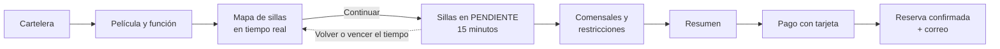

# 🎬 SensaCine

**SensaCine** es una plataforma web de **cine inmersivo con experiencia gastronómica sensorial**. Los espectadores consultan la cartelera, eligen su función y sus sillas en un mapa de sala que se actualiza **en tiempo real**, indican quién ocupará cada silla y qué **restricciones alimentarias** tiene, pagan y reciben un **correo de confirmación**.

Durante la proyección, la cocina sirve un plato individual a cada comensal, adaptado a sus restricciones. El sistema incluye además un **panel de administración** para gestionar la programación del cine.

---

## 📑 Contenido

1. [¿Qué se puede hacer?](#-qué-se-puede-hacer)
2. [Cómo funciona una reserva](#-cómo-funciona-una-reserva)
3. [Tecnologías](#-tecnologías)
4. [Cómo está construido](#-cómo-está-construido)
5. [Estado del proyecto](#-estado-del-proyecto)
6. [Dueños del proyecto](#-dueños-del-proyecto)

---

## ✨ ¿Qué se puede hacer?

### Como espectador
- **Explorar la cartelera:** buscar películas por título, filtrarlas por género y ver las funciones disponibles por fecha y horario.
- **Conocer el menú:** cada película tiene su propio menú gastronómico, con entradas, platos fuertes, postres y bebidas.
- **Elegir sillas en vivo:** el mapa de la sala muestra qué sillas están **disponibles**, **seleccionadas**, **pendientes** (alguien las está reservando) y **ocupadas**, y se actualiza sin recargar la página.
- **Reservar sin carreras:** al continuar, tus sillas quedan retenidas **15 minutos** para que completes la reserva con calma, y nadie más puede tomarlas.
- **Indicar restricciones alimentarias:** por cada silla se registra el nombre del comensal y sus alergias o restricciones, para que la cocina prepare su menú.
- **Pagar y recibir confirmación:** el pago se hace con una tarjeta simulada y llega un **correo** con la película, la fecha, la hora, la sala, las sillas y el monto pagado.
- **Consultar sus reservas:** "Mis reservas" muestra las próximas funciones y el historial, con el detalle de cada una.

### Como administrador
Un panel para gestionar **películas**, **funciones** (con control de choques de horario), **salas y sus asientos**, el **menú gastronómico**, los **usuarios** (roles y estado de cada cuenta) y las **reservas**.

---

## 🔄 Cómo funciona una reserva

1. El espectador elige una función y sus sillas. Los demás ven el mapa actualizarse al instante.
2. Al continuar, las sillas quedan retenidas durante 15 minutos.
3. Indica quién ocupará cada silla y sus restricciones alimentarias, y revisa el resumen.
4. Al pagar, la reserva se confirma y el cobro se realiza **en una sola operación**: si algo falla, no se cobra ni queda nada a medias.
5. Las sillas pasan a ocupadas para todos y llega el correo de confirmación.

Si el espectador vuelve atrás o se agota el tiempo, las sillas se liberan de inmediato para los demás.

---

## 🧰 Tecnologías

| Parte | Tecnologías |
| :--- | :--- |
| **Interfaz web** | React 18, TypeScript, Vite, Tailwind CSS, React Query, Zustand |
| **Servidor** | Node.js, TypeScript, Express, Zod |
| **Base de datos** | PostgreSQL con Prisma ORM |
| **Tiempo real** | Socket.IO |
| **Seguridad** | Autenticación con JWT y control de acceso por roles |
| **Correo** | API de Gmail o SMTP |
| **Pruebas** | Jest |

---

## 🧱 Cómo está construido

El repositorio reúne dos aplicaciones independientes que se comunican por HTTP y por WebSocket. Cada una tiene su propio README con la explicación técnica de cómo está construida, sus carpetas y su ejecución:

| Aplicación | Qué contiene | Documentación |
| :--- | :--- | :--- |
| 🖥️ **Frontend** (`frontend/`) | La interfaz web que usan espectadores y administradores. | **[README del Frontend](./frontend/README.md)** |
| ⚙️ **Backend** (`sensacine-backend/`) | La API, el tiempo real, el correo y la base de datos. | **[README del Backend](./sensacine-backend/README.md)** |

---

## 📌 Estado del proyecto

**Disponible hoy:** cuentas y roles, cartelera y menú por película, sillas en tiempo real con reserva temporal, comensales y restricciones alimentarias, pagos simulados, correo de confirmación, "Mis reservas" y el panel de administración completo.

**Próximamente:**
- **Panel de cocina** para gestionar las órdenes de cada comensal.
- **Reseñas** de las funciones a las que se asistió.
- **Cancelación de reservas** por parte del espectador.

> Los pagos son una **simulación**: no se procesan tarjetas reales.

---

## 👥 Dueños del proyecto

- Andrés Felipe Medina Díaz
- Juan David Agudelo Diago
- Cesar Andrés Díaz Jimenez
- Sharon Abella Zuray Díaz
